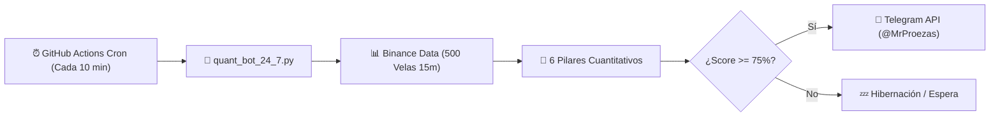

# ⚡ BTC Quant Terminal V6.1 — @MrProezas Edition

> **Terminal Cuantitativa Autónoma de Bitcoin (BTC/USDT) con Vigilancia Cloud 24/7 mediante GitHub Actions y Alertas en Tiempo Real a Telegram.**

[](https://github.com/elgrantimerio-max/btctradingbot/actions)
[](LICENSE)
[](https://www.python.org/)

---

## 🎯 Objetivo del Sistema

Capturar expansiones intradía de **1.200 a 1.500 puntos (USD)** en Bitcoin (BTC/USDT) en operaciones en **Largo (LONG)** o **Corto (SHORT)**, avisando en tiempo real por **Telegram directamente a Telegram tanto del momento exacto de **ENTRADA** como de **SALIDA**, funcionando de forma **100% autónoma en la nube las 24 horas del día, los 7 días de la semana, independientemente de que tu navegador u ordenador estén abiertos o apagados**.

---

## ☁️ ¿Cómo Funciona la Automatización Cloud 24/7?



1. **GitHub Actions Runner:** Cada 10 minutos (`*/10 * * * *`), los servidores de GitHub ejecutan en la nube el script [`quant_bot_24_7.py`](quant_bot_24_7.py).
2. **Sin dependencias pesadas:** Utiliza exclusivamente librerías estándar de Python 3 para ejecutarse en menos de 3 segundos con 100% de fiabilidad.
3. **Evaluación de los 6 Pilares:**
   - **Filtro de Sesión:** Londres (08:00-16:30 UTC), NY (13:30-21:00 UTC) y Overlap Londres-NY (13:30-16:30 UTC).
   - **Detector Anti-Chop:** Choppiness Index (14) y ADX (14). Si `Chop > 61.8` y `ADX < 22`, bloquea entradas (`MODO HIBERNACIÓN`).
   - **Cajón ORB (8h) + ADR 24h:** Evalúa el rango de apertura y el combustible disponible respecto a los 2.500 pts promedio.
   - **Estructura VWAP 24h + EMAs 20, 50, 100, 200 + RSI (14):** Alineación rápida y macro-institucional.
   - **Flujo de Órdenes (CVD + RVOL > 1.2x):** Confirmación por Delta de Volumen Acumulado y volumen relativo.
   - **Mapa de Liquidaciones y Barridos (SFP):** Detección de trampas en piscinas de 25x, 50x y 100x.
4. **Despacho Inmediato:** Si la confluencia alcanza $\ge 75\%$, emite de forma instantánea la alerta detallada a Telegram con Entrada, Stop-Loss, TP1 (+750 pts) y TP2 (+1.350 pts).
5. **Caché Anti-Duplicados:** Guarda el identificador de la vela analizada en `last_alert.json` para no repetir alertas innecesarias sobre la misma vela.

## 🛡️ Estructura del Proyecto

```text
├── .github/
│   └── workflows/
│       └── quant_guardian_24_7.yml  # Automatismo Cloud 24/7 (Cron: cada 10 min)
├── index.html                       # Terminal Web Full-Stack (HTML5, CSS3, JS ES6+)
├── quant_bot_24_7.py                # Motor Cuantitativo Headless en Python 3
├── quant_bot_24_7.js                # Motor Cuantitativo Companion en Node.js
├── .gitignore                       # Filtro de exclusión para Git
└── README.md                        # Documentación institucional y guía de despliegue
```

---

*Desarrollado con arquitectura cuantitativa de grado institucional para **@MrProezas**.*
