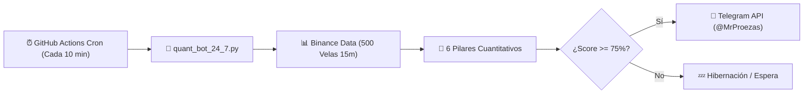

# ⚡ BTC Quant Terminal V6.1 — @MrProezas Edition

> **Terminal Cuantitativa Autónoma de Bitcoin (BTC/USDT) con Vigilancia Cloud 24/7 mediante GitHub Actions y Alertas en Tiempo Real a Telegram.**

[](https://github.com/elgrantimerio-max/btctradingbot/actions)
[](LICENSE)
[](https://www.python.org/)

---

## 🎯 Objetivo del Sistema

Capturar expansiones intradía de **1.200 a 1.500 puntos (USD)** en Bitcoin (BTC/USDT) en operaciones en **Largo (LONG)** o **Corto (SHORT)**, avisando en tiempo real por **Telegram directamente a @MrProezas (Chat ID: 159239770)** tanto del momento exacto de **ENTRADA** como de **SALIDA**, funcionando de forma **100% autónoma en la nube las 24 horas del día, los 7 días de la semana, independientemente de que tu navegador u ordenador estén abiertos o apagados**.

---

## ☁️ ¿Cómo Funciona la Automatización Cloud 24/7?



1. **GitHub Actions Runner:** Cada 10 minutos (`*/10 * * * *`), los servidores de GitHub ejecutan en la nube el script [`quant_bot_24_7.py`](quant_bot_24_7.py).
2. **Sin dependencias pesadas:** Utiliza exclusivamente librerías estándar de Python 3 para ejecutarse en menos de 3 segundos con 100% de fiabilidad.
3. **Evaluación de los 6 Pilares:**
   - **Filtro de Sesión:** Londres (08:00-16:30 UTC), NY (13:30-21:00 UTC) y Overlap Londres-NY (13:30-16:30 UTC).
   - **Detector Anti-Chop:** Choppiness Index (14) y ADX (14). Si `Chop > 61.8` y `ADX < 22`, bloquea entradas (`MODO HIBERNACIÓN`).
   - **Cajón ORB (8h) + ADR 24h:** Evalúa el rango de apertura y el combustible disponible respecto a los 2.500 pts promedio.
   - **Estructura VWAP 24h + EMAs 20, 50, 100, 200 + RSI (14):** Alineación rápida y macro-institucional.
   - **Flujo de Órdenes (CVD + RVOL > 1.2x):** Confirmación por Delta de Volumen Acumulado y volumen relativo.
   - **Mapa de Liquidaciones y Barridos (SFP):** Detección de trampas en piscinas de 25x, 50x y 100x.
4. **Despacho Inmediato:** Si la confluencia alcanza $\ge 75\%$, emite de forma instantánea la alerta detallada a Telegram con Entrada, Stop-Loss, TP1 (+750 pts) y TP2 (+1.350 pts).
5. **Caché Anti-Duplicados:** Guarda el identificador de la vela analizada en `last_alert.json` para no repetir alertas innecesarias sobre la misma vela.

---

## 🚀 Pasos para Subir y Activar en GitHub

### Opción A: Desde la Consola (Git CLI)

Si tienes `git` instalado en tu sistema, ejecuta estos comandos en la carpeta del proyecto:

```bash
# 1. Inicializar repositorio git local
git init

# 2. Agregar todos los archivos
git add .

# 3. Crear el primer commit
git commit -m "feat: desplegar BTC Quant Terminal V6.1 con automatismo 24/7"

# 4. Establecer la rama principal
git branch -M main

# 5. Vincular con tu repositorio remoto
git remote add origin https://github.com/elgrantimerio-max/btctradingbot.git

# 6. Subir los archivos a GitHub
git push -u origin main
```

---

### Opción B: Mediante GitHub Desktop o Web (Arrastrar y Soltar)

1. Entra a tu repositorio: [**https://github.com/elgrantimerio-max/btctradingbot**](https://github.com/elgrantimerio-max/btctradingbot)
2. Si el repositorio está vacío, pulsa en **"uploading an existing file"** (o en **Add file > Upload files**).
3. Arrastra todos los archivos de esta carpeta (incluida la carpeta `.github/` con el workflow).
4. Pulsa en **"Commit changes"**.

---

## 🌐 Cómo Activar la Web Online (GitHub Pages Gratuito)

Para tener el terminal interactivo accesible desde cualquier móvil o navegador las 24 horas:

1. En tu repositorio GitHub, ve a **Settings** (pestaña superior derecha).
2. En el menú lateral izquierdo, haz clic en **Pages**.
3. En **Build and deployment > Source**, selecciona:
   - **Branch:** `main`
   - **Folder:** `/ (root)`
4. Haz clic en **Save**.
5. En unos segundos, tu terminal estará disponible públicamente en:
   👉 **`https://elgrantimerio-max.github.io/btctradingbot/`**

---

## ⚙️ Configuración de Secretos en GitHub (Opcional)

Las credenciales ya vienen preconfiguradas con fallback por defecto, pero si deseas definirlas como Secretos cifrados en GitHub:

1. Ve a **Settings > Secrets and variables > Actions > New repository secret**.
2. Añade:
   - `TELEGRAM_BOT_TOKEN`: `8635759809:AAF8YTMVkbVizhe2V7ciw_QtOktDqapJWo4`
   - `TELEGRAM_CHAT_ID`: `159239770`
3. ¡Listo! El workflow los utilizará de forma automática.

---

## 📱 Verificación del Workflow

Una vez subido el código:
1. Ve a la pestaña **Actions** en tu repositorio de GitHub.
2. Verás el flujo **BTC Quant Guardian 24/7 (Telegram Automatism)**.
3. Puedes esperar a la siguiente ejecución automática (cada 10 minutos) o pulsar en **Run workflow** para forzar un escaneo manual inmediato.

---

## 🛡️ Estructura del Proyecto

```text
├── .github/
│   └── workflows/
│       └── quant_guardian_24_7.yml  # Automatismo Cloud 24/7 (Cron: cada 10 min)
├── index.html                       # Terminal Web Full-Stack (HTML5, CSS3, JS ES6+)
├── quant_bot_24_7.py                # Motor Cuantitativo Headless en Python 3
├── quant_bot_24_7.js                # Motor Cuantitativo Companion en Node.js
├── .gitignore                       # Filtro de exclusión para Git
└── README.md                        # Documentación institucional y guía de despliegue
```

---

*Desarrollado con arquitectura cuantitativa de grado institucional para **@MrProezas**.*
