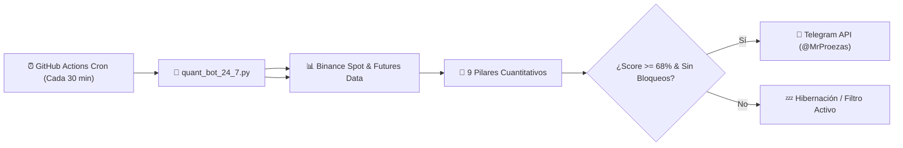

# ⚡ BTC Quant Terminal V6.5 — @MrProezas Edition

> **Terminal Cuantitativa Autónoma de Bitcoin (BTC/USDT) con Enfoque Híbrido Doble Nivel ($20k/$40k), Matriz Multi-Temporal en Tiempo Real, Índice de Confluencia Calibrado a 100 Puntos, Vigilancia Cloud 24/7 mediante GitHub Actions y Alertas Instantáneas a Telegram.**

[](https://github.com/elgrantimerio-max/btctradingbot/actions)
[](LICENSE)
[](https://www.python.org/)

---

## 🎯 Objetivo del Sistema

Capturar expansiones intradía de **1.200 a 1.500 puntos (USD)** en Bitcoin (BTC/USDT) en operaciones en **Largo (LONG)** o **Corto (SHORT)** con **Win Rate superior al 65%-70%** y una frecuencia operativa óptima (8 a 15 operaciones por cada 500 velas de 15m), avisando en tiempo real por **Telegram** tanto del momento exacto de **ENTRADA** como de **SALIDA**, funcionando de forma **100% autónoma en la nube las 24 horas del día, los 7 días de la semana**.

---

## 🌐 Novedades V6.5: Enfoque Híbrido Doble Nivel y Auditoría del Índice de Confluencia

La versión 6.5 introduce mejoras estructurales tanto en la analítica de confluencia como en la gestión de capital:

1. **Enfoque Híbrido Doble Nivel ($20.000 / $40.000 USD):**
   - **Operación Estándar ($20k / 0.25 BTC):** Se activa cuando el score alcanza el umbral mínimo ($\ge 68\%$).
   - **Operación Acelerada A+ ($40k / 0.50 BTC):** Se activa automáticamente cuando la señal tiene confluencia completa de volumen y flujo institucional (Score $\ge 68\%$, RVOL $\ge 1.0\times$ y CVD Delta estrictamente alineado con la dirección).
   - El *Live Position Desk* y las alertas automáticas de Telegram reflejan en tiempo real el tier correspondiente (`💎 A+ $40k` o `$20k`).
2. **Auditoría y Calibración Matemática del Índice de Confluencia (100 Puntos Exactos):**
   - **Pilar 1 - Filtro de Sesión:** Londres, NY, Overlap $\rightarrow$ Máx 15 pts.
   - **Pilar 2 - Régimen Anti-Chop & TTM Squeeze:** Choppiness + ADX $\rightarrow$ Máx 15 pts.
   - **Pilar 3 - Ruptura ORB & Combustible ADR 24h:** $\rightarrow$ Máx 15 pts.
   - **Pilar 4 - Estructura Técnica y Momentum:** VWAP + EMAs 20/50/100/200 + Ichimoku Kumo + RSI(14) + Velas de Momentum $\rightarrow$ Máx 34 pts.
   - **Pilar 5 - Order Flow & Dinero Nuevo:** CVD Delta + RVOL + Futuros OI Delta $\rightarrow$ Máx 15 pts.
   - **Pilar 6 - Barridos de Liquidez SFP Institucional:** $\rightarrow$ Máx 6 pts.
   - **Suma Total Exacta:** $15 + 15 + 15 + 34 + 15 + 6 = 100\text{ pts}$.
3. **Mejoras Visuales en el Radar de Confluencia:**
   - **Coloreado Dinámico de Pilares:** Verde para pilares fuertes ($\ge 70\%$), Dorado para intermedios ($40-69\%$) y Atenuado para débiles ($< 40\%$).
   - **Alineación de Desglose en Neutro/Bias:** La tarjeta de pilares ahora siempre refleja los valores del lado dominante, evitando discrepancias en el monitor.
   - **Corrección de Metadatos SL/TP:** Contenedor de objetivos responsivo en *Live Position Desk* con cálculo unificado en Long/Short.

---

## ☁️ ¿Cómo Funciona la Automatización Cloud 24/7?



1. **GitHub Actions Runner:** Cada 30 minutos (`*/30 * * * *`), los servidores de GitHub ejecutan en la nube el script [`quant_bot_24_7.py`](quant_bot_24_7.py).
2. **Sin dependencias externas pesadas:** Utiliza librerías estándar de Python 3 para ejecutarse en menos de 3 segundos con 100% de fiabilidad en GitHub Actions.
3. **Evaluación de los 9 Pilares Cuantitativos Institucionales:**
   - **Filtro de Sesión:** Londres (08:00-16:30 UTC), NY (13:30-21:00 UTC) y Overlap Londres-NY (13:30-16:30 UTC).
   - **Detector Anti-Chop & TTM Squeeze Pro:** Choppiness Index (14) + ADX (14) + TTM Squeeze (Carter). Si hay compresión (puntos rojos de bandas dentro de canales Keltner), **bloquea quiebres falsos**. Solo dispara con expansión (puntos verdes). Si `Chop > 61.8` y `ADX < 22`, activa `MODO HIBERNACIÓN`.
   - **Cajón ORB (8h) + Combustible ADR 24h:** Evalúa el rango de apertura y el margen de recorrido disponible respecto al benchmark de 2.500 pts.
   - **Estructura VWAP 24h + EMAs 20, 50, 100, 200 + RSI (14):** Confluencia de tendencia rápida y macro-institucional con controles independientes de visualización para EMA 20 y EMA 50.
   - **Filtro Macro Ichimoku Kumo (1H y 4H):** **Regla de oro institucional:** Prohibido abrir compras si el precio está por debajo de la nube bajista Kumo; prohibido abrir ventas si está por encima de la nube alcista Kumo.
   - **Flujo de Órdenes & Filtro de Dinero Nuevo (CVD + OI Delta):** Compara el Delta de Volumen Acumulado con la variación en el Interés Abierto de Futuros Binance (FAPI). Si el precio sube pero el OI cae, detecta cierre de cortos (rebote falso sin dinero fresco) y anula la compra.
   - **Mapa de Liquidaciones y Barridos (SFP Calibrado a 8 pts):** Ponderación calibrada para evitar compras a la contra en caídas fuertes macro.
4. **Despacho Inmediato:** Si la confluencia alcanza $\ge 68\%$ y no hay bloqueos de Kumo o Squeeze, emite de forma instantánea la alerta detallada a Telegram con Entrada, Stop-Loss adaptativo y objetivos TP1 y TP2.
5. **Caché Anti-Duplicados y Estado:** Guarda `last_alert.json` y `state.json` con el histórico de Open Interest para calcular el delta continuo.

---

## 🛡️ Estructura del Proyecto

```text
├── .github/
│   └── workflows/
│       └── quant_guardian_24_7.yml  # Automatismo Cloud 24/7 (Cron: cada 10 min)
├── index.html                       # Terminal Web Full-Stack (HTML5, CSS3, JS ES6+)
├── quant_bot_24_7.py                # Motor Cuantitativo Headless en Python 3
├── quant_bot_24_7.js                # Motor Cuantitativo Companion en Node.js
├── .gitignore                       # Filtro de exclusión para Git
└── README.md                        # Documentación institucional y guía de despliegue
```

---

*Desarrollado con arquitectura cuantitativa de grado institucional para **@MrProezas**.*
